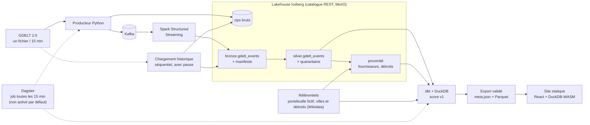

# Radar de risque supply chain

Un pipeline de données complet, de la presse mondiale à un score de risque par fournisseur : **18,4 millions d'événements GDELT** sur 175 jours de chargement historique, un lakehouse Apache Iceberg, un score calculé avec dbt, et un site statique qui lit des fichiers Parquet directement dans le navigateur.

> **Démo** : <https://hamzaelchen.github.io/supply-chain-risk-radar/> (disponible dès que GitHub Pages est activé sur le dépôt).
> **Le portefeuille de fournisseurs est fictif** (« Entreprise démo », basée à Casablanca). Les événements, les villes et les détroits sont réels.

## Le problème

Une entreprise qui achète dans 24 pays se demande, chaque matin : *un de mes fournisseurs, ou un détroit par lequel passe sa marchandise, subit-il quelque chose d'inhabituel ?* Les articles de presse le disent avant les systèmes internes, mais ils sont des millions et leur volume dépend de la ville plus que du risque : Los Angeles produit mille événements là où une ville industrielle moyenne en produit un.

Ce projet transforme le flux d'événements de [GDELT](https://www.gdeltproject.org/) en un score de 0 à 100 par fournisseur, en répondant à une seule question : **est-ce plus que la normale de cette ville et de ce détroit ?**

## Ce que fait le pipeline

1. **Ingère** GDELT 2.0 toutes les 15 minutes (producteur Python, Kafka, Spark Structured Streaming) et charge un historique en lot (outil séquentiel, avec pause, reprenable).
2. **Nettoie** dans Iceberg : bronze (ligne brute + lignage), silver (typage strict, quarantaine motivée, dédoublonnage idempotent).
3. **Localise** : événements à moins de 150 km de la ville de chaque fournisseur, et dans le rayon des détroits de sa route.
4. **Note** avec dbt (DuckDB lit Iceberg) : anomalie par rapport à la normale sur 28 jours, événements négatifs classés par règles sur les codes CAMEO, criticité du fournisseur, événements explicatifs conservés.
5. **Publie** un export validé (`meta.json` + Parquet) et un site React + DuckDB-WASM, sans serveur ni API.

## Chiffres réels

| | |
|---|---|
| Événements GDELT en bronze | **18 413 458**, dans 16 960 lots de 15 minutes |
| Période | 177 jours entre le 2026-01-04 et le 2026-10-10 (deux périodes chargées en lot, volontairement avec un trou d'avril à juillet) |
| Doublons | **0** (vérifié sur le manifeste, l'identité fichier + ligne, les offsets Kafka et les identifiants GDELT) |
| Lots GDELT publiés | 16 960 ; 0 absent, 0 en échec (une seule tentative en 404, retentée puis publiée) |
| Silver | 18 413 351 événements ; **107** en quarantaine (0,0006 %), chacun avec sa raison |
| Événements localisés à une ville précise | 10,8 millions (59 %) |
| Paires (événement, fournisseur) | 2,2 millions ; 268 000 paires (événement, détroit) |
| Construction du gold complet (dbt) | environ 10 secondes |
| Tests | 291 tests Python (dont 37 d'intégration), 34 tests dbt (sur 52 éléments : 18 modèles, 1 seed), 21 tests du site |

## Cas d'étude : Ormuz, février-mars 2026

Le site s'ouvre sur cet épisode. Sans l'avoir cherché, le score le fait ressortir : dans le rayon de 200 km du détroit d'Ormuz, GDELT localise **1 568 événements la semaine du 9 février, 3 601 celle du 23 février et 8 897 celle du 2 mars**. Au 2 mars 2026, les 11 fournisseurs fictifs dont la route passe par ce détroit sont tous en alerte ou critiques (2 critiques), alors que le portefeuille entier n'en compte que 12 sur 100.

Le site montre ce que les articles recensent ; **il n'établit pas la cause**.

## Architecture



## Décisions techniques clés

| Décision | Pourquoi | Écarté |
|---|---|---|
| **Anomalie par rapport à la normale** de chaque ville et de chaque détroit (28 jours, volumes ramenés à 100 000 événements GDELT par jour) | Le nombre brut d'événements mesure la couverture médiatique ; le volume mondial varie de 65 000 à 130 000 par jour | Seuil fixe, classement entre villes |
| **Un article, une voix** par fournisseur et par détroit ; jamais de niveau critique sans 3 articles distincts | Un pic de 8 événements issus de 5 articles avait mis Gibraltar « critique » : trouvé sur les vraies données, corrigé | Comptage des événements bruts |
| **Pas de double comptage** : un événement compté près de la ville n'est pas recompté dans la composante « route » | Sinon une même histoire pèserait deux fois | |
| **Classification par règles CAMEO**, sourcées sur la table officielle de GDELT, chaque règle mesurée | Pas de LLM ni de clé d'API : zéro coût, reproductible, auditable | LLM (prévu en v2 pour les seules alertes affichées) |
| **Un seul lieu précis** : villes seulement, pas les centroïdes de pays | 18 % des paires « proches » venaient d'un centroïde (l'événement « Belgique » compté à Anvers) | Tous les types de lieu |
| **dbt-duckdb** pour le gold, DuckDB lit Iceberg via le catalogue REST | Aucune JVM de plus ; sorties en Parquet pour le navigateur ; 18 M d'événements notés en 10 s | dbt-spark |
| **Silver : MERGE sans UPDATE, curseur sur `ingested_at`** | Idempotent, rejouable, survit à l'expiration des snapshots ; le premier arrivé gagne | Lecture incrémentale par snapshots |
| **Historique en lot hors Kafka**, mêmes tables, identité (fichier, ligne) | La rétention de Kafka est de 7 jours et un historique n'est pas un flux | Rejouer dans Kafka |
| **Exportation validée, site sans API** | Le site affiche, il ne recalcule jamais un score ; un fichier invalide fait échouer l'export | Backend d'API |
| **Respect de GDELT et de l'IMF** : téléchargements séquentiels avec pause ; IMF PortWatch écarté (ses conditions interdisent le téléchargement automatisé) | Une source qu'on n'a pas le droit d'automatiser n'est pas une source | |

L'historique complet des décisions, avec les mesures qui les motivent, est dans [CLAUDE.md](CLAUDE.md).

## Limites

- **Des faux positifs sont possibles.** La classification par règles ne voit pas le contexte (un combat dans une zone de guerre ancienne retenu près d'un fournisseur). L'anomalie par rapport à la normale limite l'effet des zones chroniquement violentes, sans le supprimer.
- **Le portefeuille et les routes sont fictifs ou simplifiés.** Les villes sont à leur centre (pas leur port), le rayon des détroits est un choix de conception, la route est unique par région d'origine.
- **Le score s'arrête au dernier jour complet** (jusqu'à 24 h de retard) et se calcule sur 3 jours : c'est une aide à la surveillance, pas une prévision.
- **Les paramètres ont été fixés avant d'observer l'historique complet** (puis recalibrés une fois : voir CLAUDE.md) ; ils ne sont pas validés au-delà de cet épisode.
- Des noms de lieux sont abîmés **par GDELT lui-même** (« Abu Z¸aby », « Ad Daw?ah » : vérifié dans les octets bruts) ; ils sont affichés tels quels.
- Les fournisseurs d'une même ville ont les mêmes composantes E et T ; seules la criticité et la route les distinguent.
- Le catalogue Iceberg REST est une image de développement (`iceberg-rest-fixture`, base SQLite) : à remplacer pour autre chose qu'une démo.

## Lancer en local

Prérequis : Linux ou WSL2, Docker, Java 17, Python 3.11, Node 24 (pour le site). Environ 10 Go de mémoire pour les jobs Spark sur l'historique.

```bash
make setup && make jars          # venv, dépendances ; jars Spark (environ 800 Mo, une fois)
make up                          # Kafka, MinIO, catalogue Iceberg REST (Docker)
make ref && make portfolio       # référentiels et portefeuille fictif
make produce && make bronze      # un cycle GDELT : téléchargement, Kafka, bronze
make silver && make proximity    # typage, quarantaine, événements proches
make gold && make export         # score (dbt, tests) puis export validé
make backfill ARGS="--range 2026-01-04:2026-03-31 --dry-run"   # plan d'un chargement historique
make catchup-history             # fin d'un chargement historique : silver, proximité, gold, export
make site-data                   # instantanés du site (today + épisode d'Ormuz)
cd web && npm ci && npm run dev  # http://localhost:5173
```

- **Tests** : `make test` (sans infra), `make test-integration` (demande `make up`), `make ci-local` (même enchaînement que la CI : format, lint, tests, dbt sur un lac de test, site).
- **CI** : [.github/workflows/ci.yml](.github/workflows/ci.yml) (format, lint, tests sans infra, dbt, site).
- **Orchestration** : un job [Dagster](orchestration/definitions.py) enchaîne producteur, bronze, silver, proximité, gold et export, avec un planning toutes les 15 minutes **non activé par défaut**. `pip install -e ".[orchestration]"`, puis `make dagster` (interface) ; activer le planning dans l'onglet *Automation* ou `dagster schedule start pipeline_every_15_minutes`. Une seule exécution à la fois.
- **Services locaux** : Kafka `localhost:19092`, MinIO `19000` (console `19001`), catalogue REST `18181` ; ports décalés, liés à `127.0.0.1`, surchargeables dans `.env` ([.env.example](.env.example)).

## Sources et licences

- **Événements** : [GDELT 2.0](https://www.gdeltproject.org/) (Global Database of Events, Language, and Tone), un fichier toutes les 15 minutes, téléchargé tel quel, avec URL source et horodatage conservés jusque dans les tables. Table des codes CAMEO : publiée par GDELT ([`CAMEO.eventcodes.txt`](ref/sources/cameo/)).
- **Villes et détroits** : coordonnées lues dans [Wikidata](https://www.wikidata.org/) (**CC0**), réponse brute archivée et révision citée pour chaque point ([ref/](ref/)).
- **Portefeuille de fournisseurs : fictif** (graine fixe, étiqueté « FICTIF - Entreprise démo » dans toutes les tables et sur le site). Toute ressemblance de nom avec une société réelle est fortuite.
- IMF PortWatch n'est **pas** utilisé.

## Documentation

| | |
|---|---|
| [docs/score-v1.md](docs/score-v1.md) | Le score expliqué : formule, familles de règles, garde-fous, limites |
| [docs/portfolio.md](docs/portfolio.md) | Le portefeuille fictif, la règle de routage, la répartition |
| [docs/geo-join.md](docs/geo-join.md) | Jointure géographique : cinq méthodes mesurées, fenêtre temporelle |
| [web/CONTRACT.md](web/CONTRACT.md) | Contrat de données du site |
| [CLAUDE.md](CLAUDE.md) | Règles du projet et journal des décisions, avec leurs mesures |
| [docs/backlog.md](docs/backlog.md) | Ce qui est différé, et pourquoi |

## Organisation du dépôt

| Dossier | Contenu |
|---|---|
| [ingestion/](ingestion/) | Producteur GDELT, chargement historique, manifeste, archivage des zips |
| [streaming/](streaming/) | Job Kafka -> bronze et schéma des 61 colonnes |
| [silver/](silver/) | bronze -> silver (typage, quarantaine, MERGE), proximité, jointure géographique, récence |
| [ref/](ref/), [portfolio/](portfolio/) | Référentiels réels (Wikidata, CAMEO) ; portefeuille fictif et routage |
| [transform/](transform/) | Projet dbt (score v1), export du contrat, données du site, lac de test de la CI |
| [orchestration/](orchestration/) | Job et planning Dagster |
| [web/](web/) | Site React + DuckDB-WASM |
| [ops/](ops/), [lakehouse/](lakehouse/) | Journal des exécutions ; session Spark, jars, migrations |
| [tests/](tests/) | Tests ; les fixtures sont un vrai cycle GDELT |
