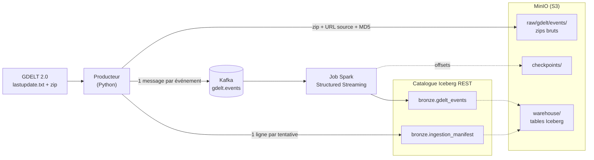

# supply-chain-risk-radar

Radar de risque supply chain. Le projet ingère les événements mondiaux de GDELT 2.0 (un fichier toutes les 15 minutes) et, à terme, le trafic portuaire d'IMF PortWatch, les stocke dans un lakehouse Apache Iceberg (bronze / silver / gold), puis calculera un score de risque de 0 à 100 pour les 100 fournisseurs d'une « Entreprise démo ».

Seul le portefeuille de fournisseurs sera fictif (graine fixe). Tous les événements viennent de fichiers réellement téléchargés, dont l'URL source et l'horodatage sont conservés jusque dans les tables.

## État d'avancement

| Phase | Contenu | État |
|---|---|---|
| 0 — Fondations locales | Infra Docker, producteur GDELT, streaming vers bronze | **Terminée** |
| 1 — Bronze / silver | Typage, dédoublonnage, quarantaine, IMF PortWatch | À venir |
| 2 — Portefeuille et gold | 100 fournisseurs, dbt, score de risque | À venir |
| 3 — Classification LLM | Taxonomie d'événements, évaluation, coûts | À venir |
| 4 — Orchestration | Dagster, planification, maintenance des tables | À venir |
| 5 — Live-lite | Export Parquet, GitHub Actions, site React + DuckDB-WASM | À venir |
| 6 — Durcissement | Qualité, observabilité, CI, documentation | À venir |

## Architecture actuelle (phase 0)

**Producteur** ([ingestion/](ingestion/)) — lit `lastupdate.txt`, télécharge le zip du créneau, vérifie son MD5, l'archive dans MinIO, puis publie chaque événement dans Kafka.

- Idempotence : la table Iceberg `bronze.ingestion_manifest` est sa seule mémoire. Un créneau déjà publié n'est pas renvoyé.
- Créneaux absents : un 404 est retenté pendant une heure, puis marqué `missing_final`. Le cycle ne s'arrête pas.
- Garantie « au moins une fois » : un arrêt entre l'envoi Kafka et l'écriture du manifeste rejoue le créneau.

L'horodatage du nom de fichier GDELT (repris dans `slot_ts` et `date_added`) est l'étiquette du lot, pas son heure de publication : le fichier est mis en ligne une dizaine de minutes avant. L'heure réelle de téléchargement est `fetched_at`.

**Topic `gdelt.events`** — 3 partitions, rétention 7 jours. La clé est le `GLOBALEVENTID`, la valeur est la ligne TSV brute. L'URL du zip, le créneau et l'heure de téléchargement voyagent dans les en-têtes Kafka.

**Job de streaming** ([streaming/](streaming/)) — écrit `bronze.gdelt_events` : la ligne brute, les 61 colonnes GDELT en `STRING`, le lignage (en-têtes Kafka, topic, partition, offset) et `ingested_at`.

- Partition par jour d'ingestion, pas par date d'événement.
- Pas de dédoublonnage en bronze : il se fera en silver.
- Le job lui-même n'ajoute pas de doublon quand on le relance : les offsets sont dans le checkpoint (MinIO) et le commit Iceberg est idempotent.
- Trigger `availableNow` : il traite ce qui attend dans Kafka, puis s'arrête.

**Versions** — Spark 4.1.3, Iceberg 1.12.0, SDK AWS 2.54.17, Kafka 4.3.1, Python 3.11. Les choix et leurs raisons sont consignés dans la section Décisions de [CLAUDE.md](CLAUDE.md).

## Démarrage

Prérequis : WSL2 ou Linux, Docker, Java 17, Python 3.11.

    make setup     # venv + dépendances
    make jars      # télécharge les jars Spark une fois (environ 800 Mo)
    make up        # démarre Kafka, MinIO et le catalogue Iceberg REST
    make smoke     # vérifie l'aller-retour Spark -> catalogue -> MinIO
    make produce   # un cycle GDELT : zip -> MinIO, événements -> Kafka
    make bronze    # Kafka -> bronze.gdelt_events

`make jars` résout les dépendances Spark (Iceberg, connecteur Kafka, `hadoop-aws`, SDK AWS) avec Ivy et les range dans `jars/<empreinte des versions>/`. Les sessions Spark locales lisent ce dossier directement. Après un changement de version, le dossier attendu change de nom et Spark refuse de démarrer en demandant de relancer `make jars`.

## Commandes make

| Commande | Effet |
|---|---|
| `make setup` | Crée le venv et installe les dépendances |
| `make jars` | Résout les jars Spark dans `jars/` ; à relancer après un changement de version |
| `make up` | Démarre l'infra Docker et attend qu'elle soit prête |
| `make down` | Arrête l'infra ; les volumes (données, catalogue, topics) sont conservés |
| `make ps` | État des conteneurs |
| `make smoke` | Crée, lit puis supprime une table Iceberg de test |
| `make produce` | Un cycle du producteur GDELT |
| `make bronze` | Job de streaming : traite ce qui attend dans Kafka, puis s'arrête |
| `make test` | Tests sans infra (environ 25 s, une JVM Spark locale démarre) |
| `make test-integration` | Tests de bout en bout ; demande `make up`, sautés sinon |

Pour faire tourner le pipeline en continu :

    .venv/bin/python -m ingestion.gdelt_producer --loop          # interroge GDELT chaque minute
    .venv/bin/python -m streaming.bronze_gdelt_events --every 60 # un lot par minute

## Services locaux

| Service | Adresse |
|---|---|
| Kafka | `localhost:19092` |
| MinIO (API S3) | `localhost:19000` |
| MinIO (console) | `localhost:19001` |
| Catalogue Iceberg REST | `localhost:8181` |

Les ports sont décalés pour cohabiter avec d'autres stacks locales et ne sont ouverts que sur `127.0.0.1`. Ports et identifiants se surchargent dans un fichier `.env` (voir [.env.example](.env.example)).

## Organisation du dépôt

| Dossier | Contenu |
|---|---|
| [ingestion/](ingestion/) | Producteur GDELT, manifeste, archivage des zips |
| [streaming/](streaming/) | Job Kafka -> bronze et schéma des 61 colonnes |
| [lakehouse/](lakehouse/) | Configuration de la session Spark, résolution des jars, smoke test |
| [tests/](tests/) | Tests ; les fixtures sont un vrai cycle GDELT, non modifié. Chaque exécution d'intégration travaille dans un namespace, des topics et un dossier qui lui sont propres, supprimés à la fin |
| `transform/`, `orchestration/`, `llm/`, `api/`, `web/` | Phases suivantes, vides pour l'instant |

## Limites connues

- Le catalogue REST est une image de développement (`iceberg-rest-fixture`), à remplacer en phase 4.
- Les petits fichiers s'accumulent (un lot par créneau, un snapshot de manifeste par créneau) : compaction et expiration des snapshots sont prévues en phase 4.
- Les jars Spark occupent environ 770 Mo dans `jars/`, dont 709 Mo pour le SDK AWS. Les dossiers des anciennes versions ne sont pas supprimés automatiquement.
